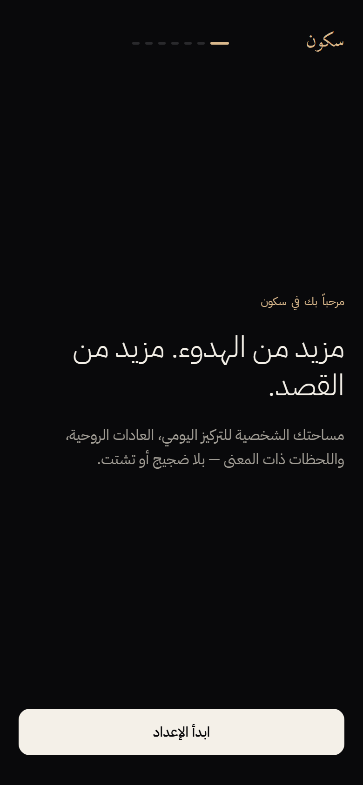
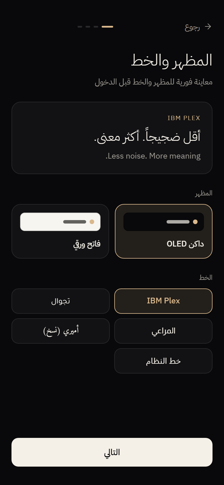
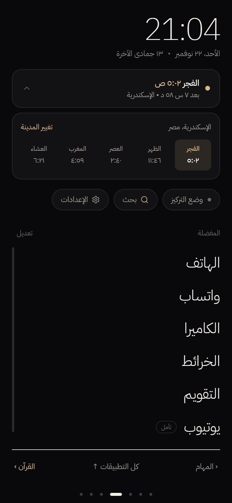
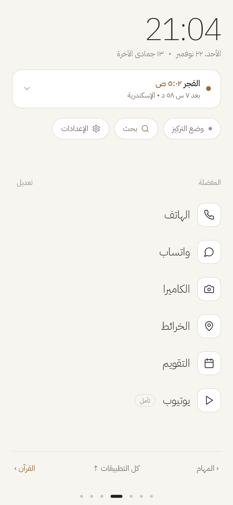
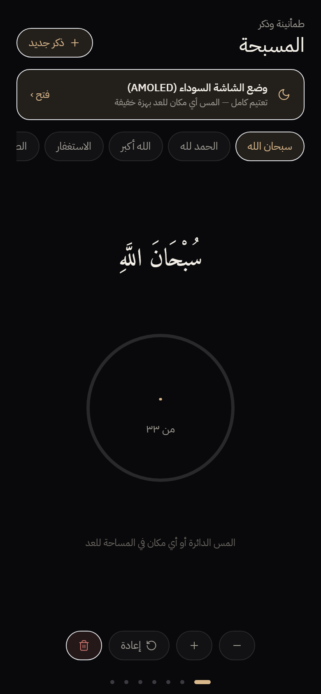
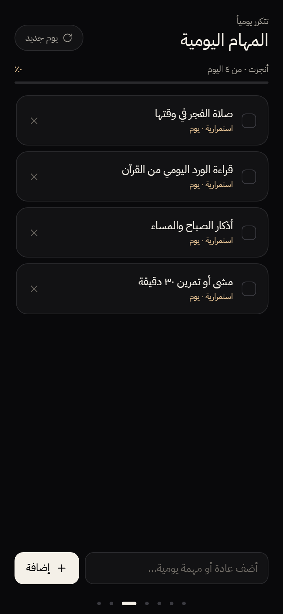

<div align="center" dir="rtl">

# سكون — Sukoon
### لانشر أندرويد مينيماليست للتركيز والسكينة الرقمية

**«أقل ضجيجاً. أكثر معنى.»**

لانشر أندرويد هادئ وخالٍ من المشتتات، مبني بـ **Kotlin و Jetpack Compose** (متوافق مع Android 8 حتى Android 15)، مع نسخة **نموذج ويب تفاعلي (React + TypeScript + Tailwind)**، يجمع بين **التقليلية الرقمية**، **الإنتاجية الهادئة**، و**العادات الإيمانية اليومية** بدون إنترنت.

</div>

---

## فلسفة سكون

بدلاً من الشاشات المزدحمة بالأيقونات الملونة والشارات الحمراء والإشعارات المتلاحقة، يحوّل **سكون** هاتفك إلى مساحة شخصية هادئة تحترم وقتك وتركيزك:

- **واجهة بلا ضجيج**: قائمة تطبيقات نصية (أو أيقونات موحدة هادئة أو أصلية حسب اختيارك).
- **درع إشعارات حقيقي أثناء التركيز**: إخفاء تام للإشعارات والأصوات والنوافذ المنبثقة عند تفعيل وضع التركيز، وتجميعها بهدوء في تابة مخصصة تذهب إليها بإرادتك.
- **يعمل 100% بدون إنترنت**: المصحف الشريف الكامل (604 صفحة)، أذكار الصباح والمساء، حساب مواقيت الصلاة الفلكي بالـ GPS أو المدينة، المهام، الملاحظات، والبومودورو.
- **تخصيص كامل**: لغتان (**العربية RTL** و**الإنجليزية LTR**)، **6 ثيمات ألوان احترافية**، **8 خطوط عربية** بـ **3 أوزان** (خفيف / عادي / عريض)، وترتيب وإخفاء التابات بحرية.

---

## رحلة الاستخدام خطوة بخطوة (App Flow)

### 1. تجربة التشغيل الأول (Guided Onboarding — 8 خطوات)

عند فتح التطبيق لأول مرة، يأخذك سكون في جولة إعداد هادئة وسريعة لتشكيل مساحتك على ذوقك (تُعرض مرة واحدة فقط ويمكن إعادتها من الإعدادات):

1. **شاشة البداية (Splash)** بتصميم OLED نقي.
2. **الترحيب (Welcome)**: تعريف سريع بفلسفة التطبيق.
3. **اختيار اللغة**: التبديل الفوري بين **العربية (RTL)** و**English (LTR)**.
4. **صمّم تجربتك**: اختيار الأقسام التي تريدها (الإنتاجية والعبادة) مع بقاء الرئيسية في المنتصف.
5. **المظهر والخط وعرض التطبيقات**: معاينة حية للثيمات الـ 6، الخطوط الـ 8، سُمك الخط، وطريقة عرض التطبيقات.
6. **موقع مواقيت الصلاة**: تحديد موقعك تلقائياً عبر **GPS** (بطلب صلاحية واضح) أو اختيار مدينتك من أكثر من **55 مدينة**.
7. **تخصيص التنقل**: ترتيب التابات يمين وشمال الشاشة الرئيسية.
8. **شاشة الاستعداد**: ملخص اختياراتك والدخول مباشرة إلى سكون.

<p align="center">
  
  &nbsp;&nbsp;
  
</p>

---

### 2. الشاشة الرئيسية ومواقيت الصلاة (Home Screen)

مركز يومك الهادئ بدون أي فوضى بصرية:

- **ساعة رقمية هادئة** مع التاريخ الميلادي والهجري معاً.
- **بطاقة الصلاة القادمة**: تعرض اسم الصلاة القادمة ووقتها والعدّاد التنازلي واسم مدينتك (أو موقعك بالـ GPS)، وعند الضغط عليها تنسدل **قائمة الصلوات الخمس كاملة** مع زر سريع لتغيير المدينة.
- **شريط التحكم السريع**: زر تفعيل/إيقاف **وضع التركيز** وزر **الإعدادات**.
- **قائمة المفضلة**: تعرض تطبيقاتك الأساسية بالنمط الذي تختاره (**نص فقط**، **أيقونات موحدة**، أو **أيقونات أصلية**)، مع شارة **«تأمل»** بجانب التطبيقات المشتتة، ووضع **تعديل** سريع للإزالة.
- **الإيماءات السريعة**:
  - **سحب يميناً أو يساراً**: التنقل بين التابات المفعّلة.
  - **سحب لأعلى**: فتح **درج كل التطبيقات** (مع البحث، إضافة للمفضلة، وتفعيل وقفة التأمل).
  - **سحب لأسفل**: فتح **البحث الشامل** (بحث في التطبيقات + آلة حاسبة فورية مثل `25*4 = 100` + اختصارات سريعة).

<p align="center">
  
  &nbsp;&nbsp;
  
  &nbsp;&nbsp;
  
</p>

---

### 3. وضع التركيز ودرع الإشعارات ووقفة التأمل (Digital Wellbeing)

مجموعة أدوات متكاملة لحماية انتباهك:

- **وضع التركيز (Focus Mode)**:
  - يُخفي التطبيقات المشتتة (مثل يوتيوب، إنستغرام، تيك توك، فيسبوك...) من الشاشة الرئيسية فوراً.
  - **حجب الإشعارات بالكامل**: عبر خدمة `NotificationListenerService` + `INTERRUPTION_FILTER_ALARMS`، يمنع ظهور أي صوت أو اهتزاز أو نافذة منبثقة (Heads-up) أو أيقونة في شريط الحالة، بينما يحفظ المكالمات والمنبهات وتنبيهات الصلاة.
- **تابة «إشعارات التركيز» المخصصة**:
  - كل الإشعارات التي تصل أثناء وضع التركيز تُجمع بهدوء داخل هذه التابة **بدون أي أرقام حمراء أو إشارات مزعجة** في الشاشة الرئيسية — أنت فقط من يسحب إليها وقت فراغك لتقرأها أو تفتح تطبيقها أو تمسحها.
- **وقفة التأمل (Mindful Pause)**:
  - قبل فتح أي تطبيق مُعلَّم كمشتت، تظهر شاشة هادئة بعدّاد دائري (`3` أو `5` أو `10` ثوانٍ حسب اختيارك) تسألك: *«خذ نفساً عميقاً... هل تحتاج حقاً لفتح هذا التطبيق الآن؟»* مع زر بارز **«رجوع إلى الهدوء»**.

---

### 4. المساحة الروحية (القرآن الكريم، الأذكار، المسبحة)

على جانب واحد من الشاشة الرئيسية تجد أدواتك اليومية للذكر والتلاوة بدون إنترنت:

1. **المصحف الشريف الكامل (604 صفحة)**:
   - نص قرآني كامل بخط **أميري** الأصيل، فواصل السور والبسملة، وأرقام الآيات المزخرفة بالذهبي الدافئ.
   - تكبير/تصغير الخط (`أ+` / `أ-`)، **الوضع الورقي** المريح للعين، انتقال مباشر لأي صفحة (`1 – 604`)، والتحكم في **تباعد السطور** (`متقارب` / `مريح 2.15×` / `واسع` / `واسع جداً`).
2. **أذكار الصباح والمساء**:
   - تبديل تلقائي حسب الوقت (صباحاً / مساءً) مع إمكانية التبديل اليدوي، شريط إنجاز، عدّاد لمسي مع اهتزاز وانتقال تلقائي للذكر التالي عند الإتمام، و**وضع الشاشة السوداء AMOLED**.
3. **المسبحة الإلكترونية**:
   - أذكار افتراضية وإمكانية إضافة أذكار مخصصة وتعديل العدد المستهدف، حلقة تقدم دائرية، عد باللمس في أي مكان، **وضع الشاشة السوداء الكاملة** للتسبيح بدون إضاءة، ودعم اختياري للعد عبر **حساس البصمة الخلفي** على الأجهزة المدعومة.

<p align="center">
  
  &nbsp;&nbsp;
  
  &nbsp;&nbsp;
  
</p>

---

### 5. مساحة الإنتاجية الهادئة (المهام، الملاحظات، البومودورو)

على الجانب الآخر من الشاشة الرئيسية تجد أدوات إنجازك اليومية بأبسط صورة ممكنة:

1. **المهام اليومية (Daily Habits)**:
   - قائمة عادات متكررة يومياً مع نسبة الإنجاز، عدّاد استمرارية (**Streak**) محسوب بالتاريخ، تصفير تلقائي عند منتصف الليل، وزر **«يوم جديد»** يدوي.
2. **الملاحظات (Notes)**:
   - مفكرة فورية بلا تعقيد مع تثبيت الملاحظات المهمة في الأعلى، بحث سريع، وحفظ تلقائي فوري.
3. **البومودورو (Pomodoro)**:
   - مؤقت تركيز دائري (`تركيز 25` / `راحة 5` / `راحة 15`)، خانة لتحديد نية الجلسة، عدّاد جلسات اليوم، وخيار **تفعيل وضع التركيز تلقائياً** بمجرد بدء جلسة العمل.

<p align="center">
  
  &nbsp;&nbsp;
  
  &nbsp;&nbsp;
  
</p>

---

### 6. الإعدادات والتخصيص الشامل (Settings)

شاشة إعدادات منظمة ومقسّمة بفلاتر سريعة (`الكل`، `المظهر والعرض`، `الروحانيات`، `التركيز والتنقل`، `النظام`) وبطاقات قابلة للطي:

- **طريقة عرض التطبيقات**: معاينة بصرية فورية للاختيار بين **نص فقط**، **أيقونات موحدة**، و**أيقونات أصلية**.
- **6 ثيمات ألوان احترافية**: `داكن OLED`، `فاتح ورقي`، `زمردي ليلي`، `أزرق ليلي`، `إسبريسو دافئ`، و`سماوي فاتح`.
- **8 خطوط عربية + 3 أوزان**: `IBM Plex`، `القاهرة`، `تجوال`، `المراعي`، `المسيري`، `كوفي`، `أميري`، و`خط النظام` — مع اختيار السُمك (`خفيف` / `عادي` / `عريض`).
- **الروحانيات**: تحديد موقع مواقيت الصلاة بالـ **GPS** أو يدوياً (55+ مدينة)، **تنبيه صوتي قبل اقتراب الصلاة** (`5 / 10 / 15 / 20 / 30 دقيقة`)، وتباعد سطور القرآن.
- **التركيز والنظام**: مدة وقفة التأمل، الاهتزاز اللمسي، ترتيب وإخفاء التابات، التحكم السريع في الصوت، صلاحيات النظام، وإعادة جولة الإعداد الأولي أو إعادة ضبط التطبيق.

<p align="center">
  
</p>

---

## هيكلة المشروع والتقنيات المستخدمة

```text
├── android/               # تطبيق الأندرويد الأصلي (Kotlin + Jetpack Compose + Material 3)
│   └── app/src/main/
│       ├── assets/        # quran_pages.json (المصحف الكامل 604 صفحة)
│       ├── java/.../data/ # النماذج، حساب مواقيت الصلاة الفلكي، الأذكار، والحفظ غير المتزامن
│       ├── java/.../service/ # حجب إشعارات التركيز، تنبيهات الصلاة، وحساس البصمة
│       └── java/.../ui/   # الثيمات، الخطوط، التوطين، وجميع الشاشات
├── web-prototype/         # تطبيق الويب التفاعلي (React 18 + TypeScript + Vite + Tailwind + Zustand)
└── docs/screenshots/      # لقطات شاشة عالية الدقة لتوثيق المشروع
```

### تشغيل وبناء المشروع

#### تطبيق الأندرويد (`android/`)
- المتطلبات: **JDK 17**، **Android SDK 35** (`minSdk = 26`, `targetSdk = 35`).
- لبناء نسخة تجريبية:
  ```bash
  cd android
  ./gradlew assembleDebug
  ```
- لبناء نسخة Release موقّعة، أضف ملف `android/signing.properties` ببيانات الـ Keystore ثم نفّذ:
  ```bash
  ./gradlew assembleRelease
  ```

#### تطبيق الويب (`web-prototype/`)
```bash
cd web-prototype
npm install
npm run dev
```
