<div align="center" dir="rtl">

# سكون — Sukoon
### لانشر أندرويد مينيماليست للتركيز، الهدوء الرقمي، والعبادة اليومية

**«أقل ضجيجاً. أكثر معنى.»**

تطبيق **سكون** هو لانشر أندرويد أصلي (**Kotlin + Jetpack Compose**) مع نموذج ويب تفاعلي (**React + TypeScript + Tailwind + Zustand**)، مصمم ليحوّل هاتفك من مصدر تشتت مستمر إلى مساحة شخصية هادئة تجمع بين **التقليلية الرقمية**، **درع إشعارات وضع التركيز**، **الإنتاجية الهادئة**، و**العادات الإيمانية اليومية** — ويعمل **100% بدون إنترنت** على جميع أجهزة أندرويد (`Android 8` حتى `Android 15`).

</div>

---

## فهرس الدليل التفصيلي
1. [جولة الإعداد الأولي (Guided Onboarding — خطوة بخطوة)](#1-جولة-الإعداد-الأولي-guided-onboarding)
2. [الشاشة الرئيسية ومواقيت الصلاة وأنماط عرض التطبيقات](#2-الشاشة-الرئيسية-ومواقيت-الصلاة-وأنماط-عرض-التطبيقات)
3. [وضع التركيز، درع حجب الإشعارات، وتابة إشعارات التركيز](#3-وضع-التركيز-ودرع-حجب-الإشعارات-وتابة-إشعارات-التركيز)
4. [وقفة التأمل (Mindful Pause)](#4-وقفة-التأمل-mindful-pause)
5. [درج التطبيقات والبحث الشامل والآلة الحاسبة الفورية](#5-درج-التطبيقات-والبحث-الشامل-والآلة-الحاسبة)
6. [المساحة الروحية: المصحف الشريف (604 صفحة)، الأذكار، المسبحة، والشاشة السوداء AMOLED](#6-المساحة-الروحية-القرآن-الأذكار-المسبحة)
7. [مساحة الإنتاجية: المهام اليومية، الملاحظات، ومؤقت البومودورو](#7-مساحة-الإنتاجية-المهام-الملاحظات-البومودورو)
8. [شاشة الإعدادات المنظمة والتخصيص الكامل (الثيمات، الخطوط، GPS، تنبيهات الصلاة)](#8-شاشة-الإعدادات-المنظمة-والتخصيص-الكامل)
9. [دليل الإيماءات والصلاحيات وبناء المشروع](#9-دليل-الإيماءات-والصلاحيات-وبناء-المشروع)

---

## 1. جولة الإعداد الأولي (Guided Onboarding)

عند فتح **سكون** لأول مرة، يمر المستخدم بجولة إعداد موجهة وسريعة من **8 خطوات** تُحفظ حالتها تلقائياً ولا تتكرر بعد الانتهاء منها (ويمكن إعادتها لاحقاً من الإعدادات):

- **الخطوة 1 — شاشة البداية (Splash) والترحيب (Welcome)**: تصميم OLED نقي يقدّم فلسفة التطبيق ويبدأ الإعداد بضغطة واحدة.
- **الخطوة 2 — اختيار اللغة**: تبديل فوري حي بين **العربية (RTL)** و**English (LTR)** يشمل كل النصوص والأرقام والتواريخ واتجاه الواجهة.
- **الخطوة 3 — صمّم تجربتك (Choose Experience)**: اختيار الأقسام التي تريد تفعيلها من قسمي **الإنتاجية** و**السكينة والعبادة**، مع بقاء الشاشة الرئيسية ثابتة في المنتصف.

<p align="center">
  
  &nbsp;&nbsp;
  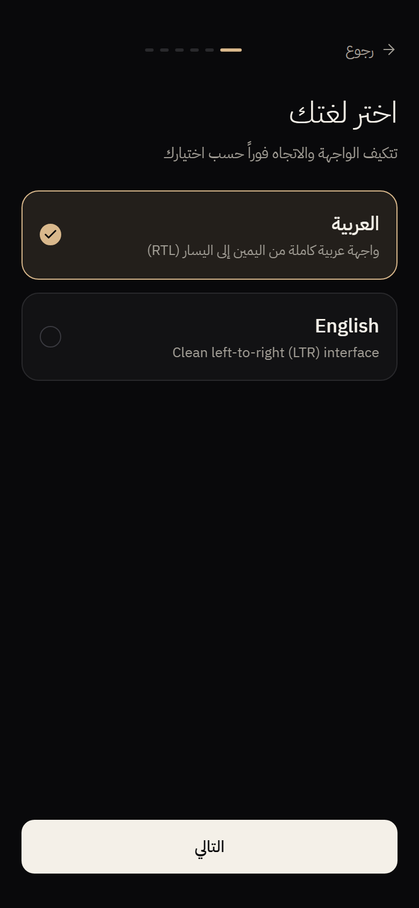
  &nbsp;&nbsp;
  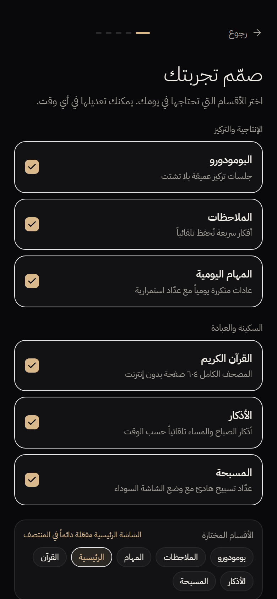
</p>

- **الخطوة 4 — المظهر والخط وعرض التطبيقات**: معاينة فورية للثيمات والخطوط والأوزان وأنماط عرض التطبيقات قبل الدخول.
- **الخطوة 5 — موقع مواقيت الصلاة**: تحديد موقعك تلقائياً عبر **GPS** (بطلب صلاحية واضح من النظام) أو البحث والاختيار من أكثر من **55 مدينة** عربية وعالمية، مع عرض وقت الصلاة القادمة مباشرة.
- **الخطوة 6 — تخصيص التنقل وترتيب التابات**: ترتيب التابات يمين وشمال الشاشة الرئيسية وإظهار أو إخفاء أي تابة حسب رغبتك، ثم شاشة **الاستعداد** والدخول إلى سكون.

<p align="center">
  
  &nbsp;&nbsp;
  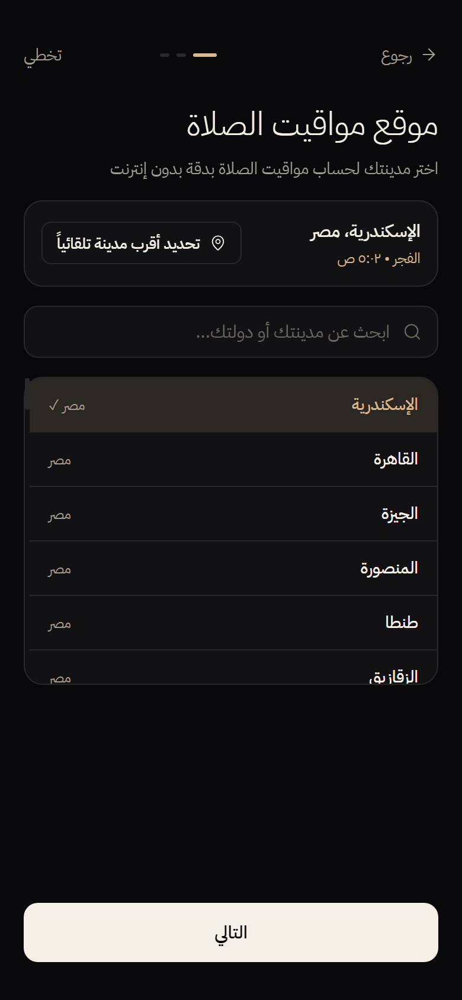
  &nbsp;&nbsp;
  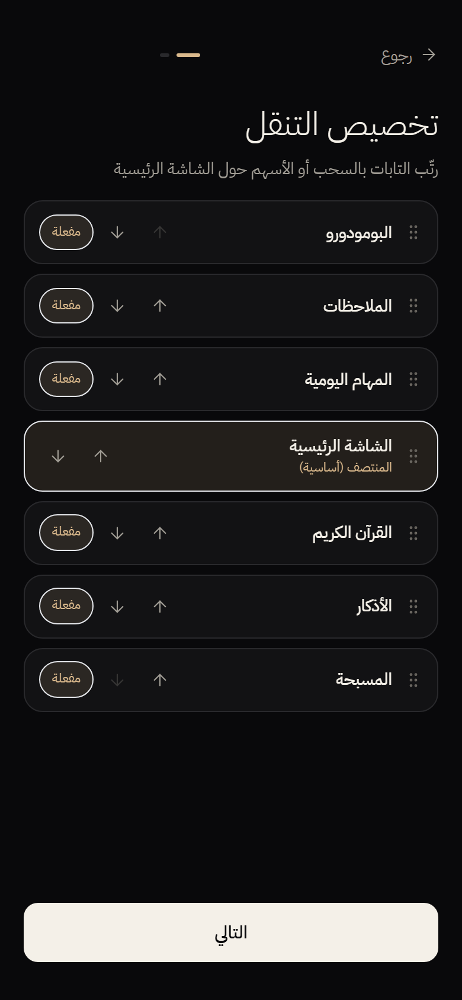
</p>

---

## 2. الشاشة الرئيسية ومواقيت الصلاة وأنماط عرض التطبيقات

الشاشة الرئيسية هي مركز يومك الهادئ بدون أي ازدحام بصري:

- **ساعة رقمية نقية** بتحديث مضبوط على بداية كل دقيقة لتقليل استهلاك البطارية، وأسفلها **التاريخ الميلادي والهجري** معاً.
- **بطاقة الصلاة القادمة**: تعرض اسم الصلاة القادمة ووقتها بنظام 12 ساعة والعدّاد التنازلي واسم مدينتك أو موقعك الجغرافي؛ وبالضغط عليها تتوسّع لعرض **جدول الصلوات الخمس كاملة** (`الفجر، الظهر، العصر، المغرب، العشاء`) مع تمييز الصلاة القادمة واختصار سريع لتغيير المدينة.
- **3 أنماط مرنة لعرض التطبيقات** (قابلة للتبديل في أي لحظة من الإعدادات):
  1. **نص فقط (Text Only)**: النمط الافتراضي المينيماليست — أسماء تطبيقات فقط بدون أي أيقونات.
  2. **أيقونات موحدة (Unified Monochrome)**: أيقونات تطبيقاتك الفعلية بتأثير أحادي هادئ متناسق مع الثيم المختار.
  3. **أيقونات أصلية (Original Icons)**: أيقونات تطبيقاتك بألوانها الطبيعية.

<p align="center">
  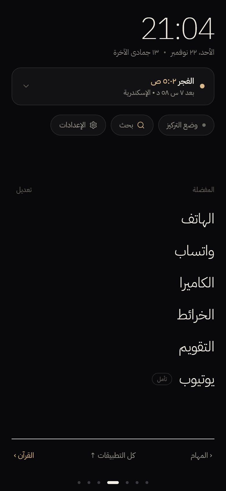
  &nbsp;
  
  &nbsp;
  
  &nbsp;
  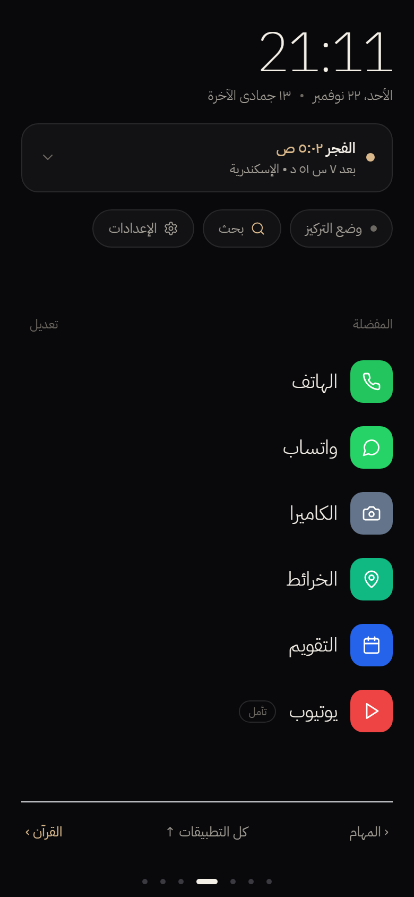
</p>

---

## 3. وضع التركيز ودرع حجب الإشعارات وتابة إشعارات التركيز

تم تصميم **وضع التركيز** ليكون درعاً حقيقياً يحمي انتباهك أثناء العمل أو المذاكرة أو العبادة:

1. **إخفاء التطبيقات المشتتة فوراً**: بمجرد تفعيل وضع التركيز، تختفي التطبيقات المشتتة (مثل يوتيوب، إنستغرام، تيك توك، فيسبوك...) من قائمة المفضلة في الشاشة الرئيسية، مع سطر هادئ يوضح عدد التطبيقات المخفية.
2. **حجب كامل للإشعارات أثناء التركيز (Android Native)**:
   - عند منح صلاحية الوصول للإشعارات وتفعيل وضع التركيز، يقوم `SukoonNotificationService` بتفعيل `INTERRUPTION_FILTER_ALARMS` لمنع **أي صوت أو اهتزاز أو نافذة منبثقة (Heads-up) أو أيقونة في شريط الحالة**، مع مسح إشعارات المجموعات (مثل واتساب) فوراً — مع استثناء المكالمات والمنبهات وتنبيهات الصلاة.
3. **تابة «إشعارات التركيز» المخصصة**:
   - كل الإشعارات التي تصل أثناء وضع التركيز تُحفظ بهدوء في تابة مستقلة داخل التطبيق **بدون أي شارات حمراء أو أرقام مزعجة في الشاشة الرئيسية**.
   - أنت فقط من يسحب إلى تابة الإشعارات وقتما تريد، لتقرأ ما وصلك وتضغط على أي إشعار لفتح تطبيقه أو تمسح الإشعارات بضغطة واحدة.

<p align="center">
  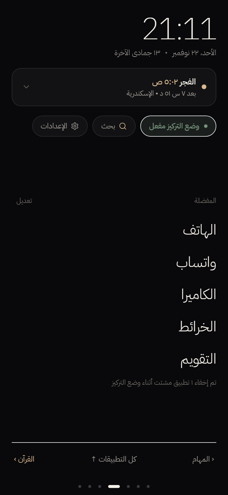
</p>

---

## 4. وقفة التأمل (Mindful Pause)

ميزة الاحتكاك الواعي لكسر عادة فتح تطبيقات التواصل بشكل لا إرادي:

- يمكنك تعليم أي تطبيق بشارة **«تأمل»** من درج التطبيقات.
- عند محاولة فتح هذا التطبيق، تظهر شاشة هادئة بعدّاد دائري (`3` أو `5` أو `10` ثوانٍ حسب اختيارك في الإعدادات) ورسالة واعية: *«خذ نفساً عميقاً... هل تحتاج حقاً لفتح [التطبيق] الآن؟»*.
- زر رئيسي واضح **«رجوع إلى الهدوء»** للعدول عن الفتح فوراً، وزر ثانوي ينفتح فقط بعد انتهاء العدّاد إذا كنت فعلاً تحتاج التطبيق.

<p align="center">
  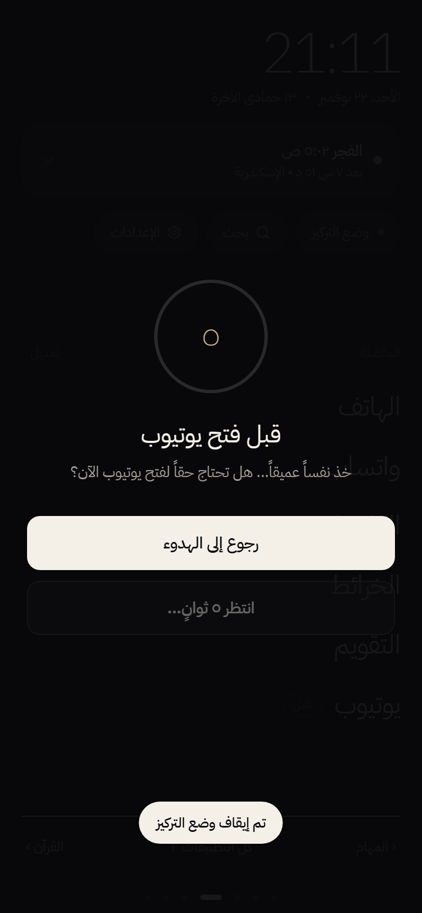
</p>

---

## 5. درج التطبيقات والبحث الشامل والآلة الحاسبة

- **درج كل التطبيقات (سحب لأعلى من الرئيسية)**: قائمة أبجدية مرتبة لكل تطبيقات جهازك (بالنمط المختار: نص فقط / أيقونات موحدة / أيقونات أصلية) مع بحث فوري، نجمة `★` للإضافة أو الإزالة من المفضلة، وزر `تأمل` لتفعيل وقفة التأمل لكل تطبيق.
- **البحث الشامل والآلة الحاسبة (سحب لأسفل من الرئيسية)**:
  - بحث فوري في التطبيقات والملاحظات، أو كتابة رقم صفحة (`1–604`) للانتقال مباشرة للمصحف.
  - **آلة حاسبة فورية مدمجة**: اكتب أي عملية حسابية مثل `25*4` لتظهر النتيجة `100` فوراً بدون فتح تطبيق آخر.
  - اختصارات سريعة للتنقل + بطاقة التحكم السريع في مستوى الصوت (الوسائط، النغمة، المنبه، وكتم سريع).

<p align="center">
  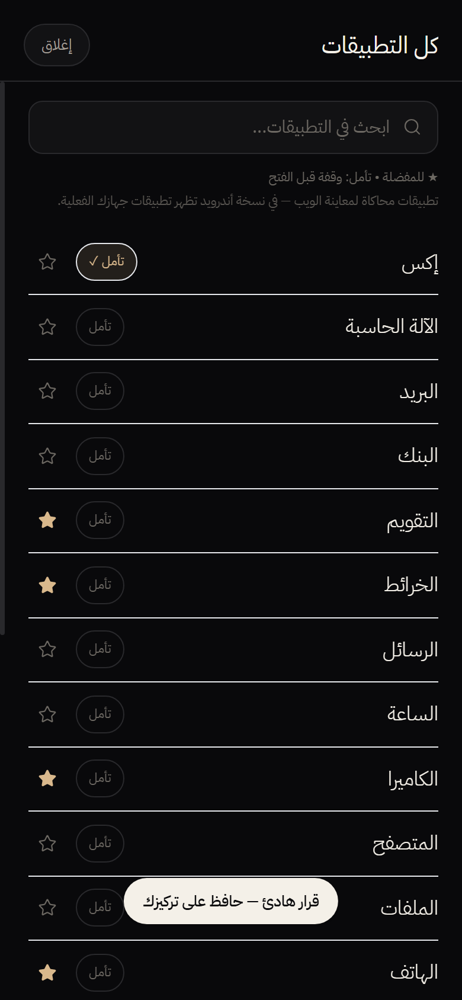
  &nbsp;&nbsp;
  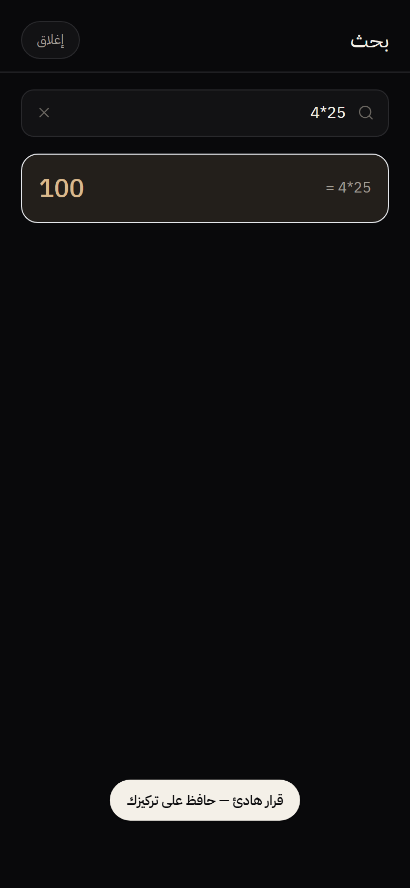
</p>

---

## 6. المساحة الروحية (القرآن، الأذكار، المسبحة)

كل الأدوات الإيمانية اليومية تعمل **100% بدون إنترنت**:

### أ) المصحف الشريف الكامل (604 صفحة)
- نص قرآني كامل بخط **أميري (Amiri)** الأصيل، مع فواصل السور والبسملة وأرقام الآيات المزخرفة بالذهبي الدافئ.
- **تباعد سطور مريح (Line Height)**: الافتراضي `2.15×` لمنع تداخل التشكيل، مع 4 مستويات (`متقارب`، `مريح`، `واسع`، `واسع جداً`).
- أزرار تكبير/تصغير الخط (`أ+` / `أ-`)، انتقال مباشر لأي صفحة (`1 – 604`)، و**الوضع الورقي (Paper Mode)** المريح للعين حتى أثناء الوضع الداكن.

### ب) أذكار الصباح والمساء
- تبديل تلقائي حسب الوقت (الصباح / المساء) مع إمكانية التبديل اليدوي، شريط إنجاز، بطاقة لمسية كبيرة بخط أميري (المس أي مكان في البطاقة للعد مع اهتزاز خفيف)، انتقال تلقائي للذكر التالي عند الإتمام، وزر **الشاشة السوداء**.

### ج) المسبحة الإلكترونية ووضع الشاشة السوداء (AMOLED)
- أذكار افتراضية + إمكانية **إضافة أذكار مخصصة** وتعديل العدد المستهدف (`+` / `-`) مع تأكيد قبل التصفير أو الحذف لتجنب الأخطاء.
- **وضع الشاشة السوداء الكاملة (AMOLED Black Screen)**: يحوّل الشاشة إلى أسود نقي `#000000` بأقل سطوع وإخفاء أشرطة النظام لتسبّح وتذكر الله باللمس في أي مكان مع اهتزاز خفيف (وضغطة مطولة للخروج).
- دعم اختياري للتسبيح عبر **حساس البصمة الخلفي** على الأجهزة المدعومة.

<p align="center">
  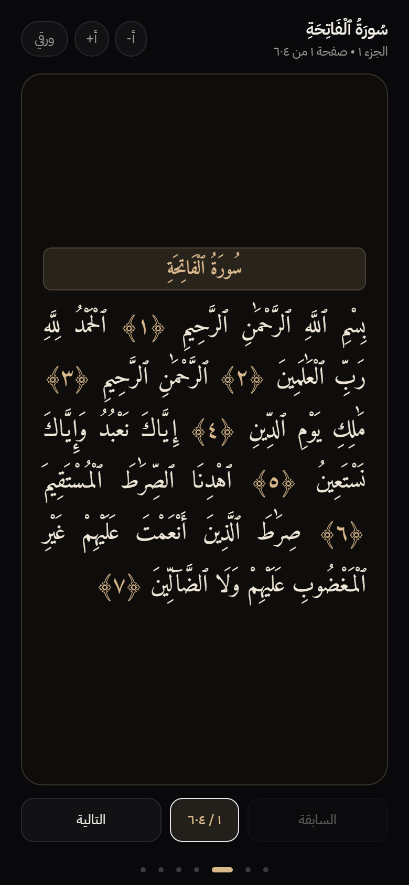
  &nbsp;
  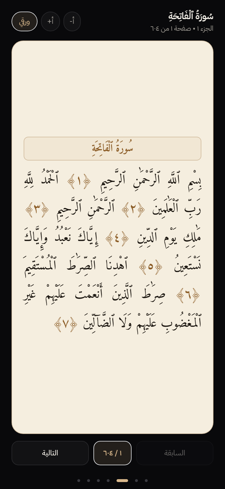
  &nbsp;
  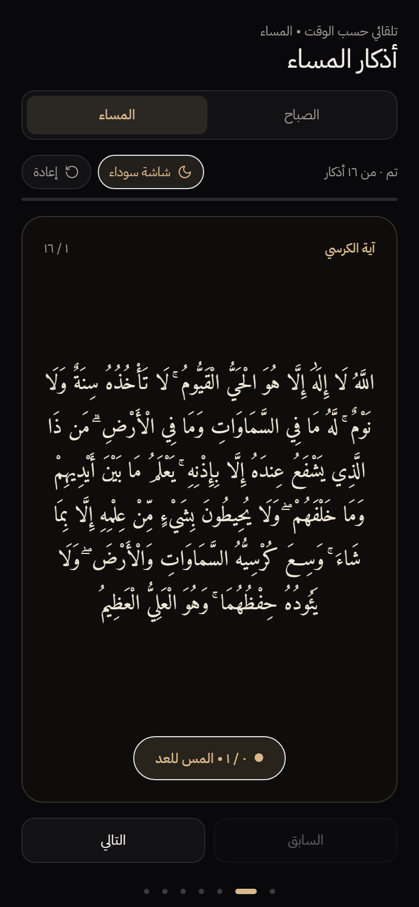
  &nbsp;
  
</p>

<p align="center">
  
</p>

---

## 7. مساحة الإنتاجية (المهام، الملاحظات، البومودورو)

### أ) المهام والعادات اليومية (Daily Habits)
- قائمة مهام متكررة يومياً مع نسبة الإنجاز وشريط التقدم، وعدّاد استمرارية (**Streak**) محسوب بدقة بالتاريخ، وتصفير تلقائي عند منتصف الليل بالإضافة لزر **«يوم جديد»** يدوي.

### ب) الملاحظات السريعة (Notes & Editor)
- قائمة ملاحظات تعرض المثبتة في الأعلى مع معاينة سريعة وبحث، ومحرر فوري خالٍ من التشتت يحفظ تلقائياً مع كل حرف مع زر التثبيت وتأكيد قبل الحذف.

### ج) مؤقت البومودورو (Pomodoro)
- 3 أوضاع (`تركيز 25`، `راحة 5`، `راحة 15`)، عدّاد دائري دقيق يعتمد على الوقت الفعلي، حقل لتحديد نية الجلسة، عدّاد جلسات اليوم، وخيار **تفعيل وضع التركيز تلقائياً** عند بدء جلسة العمل.

<p align="center">
  
  &nbsp;
  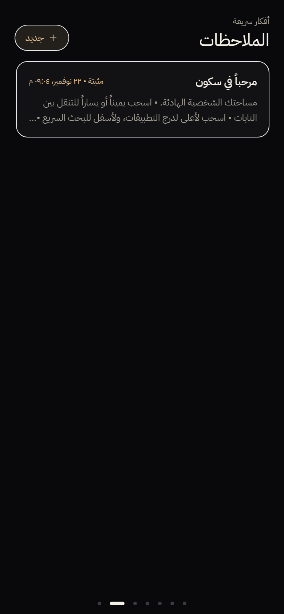
  &nbsp;
  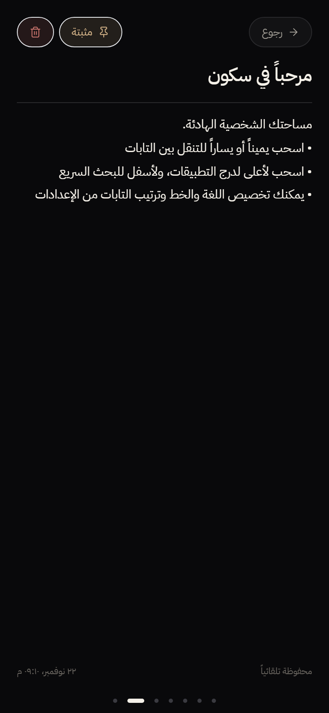
  &nbsp;
  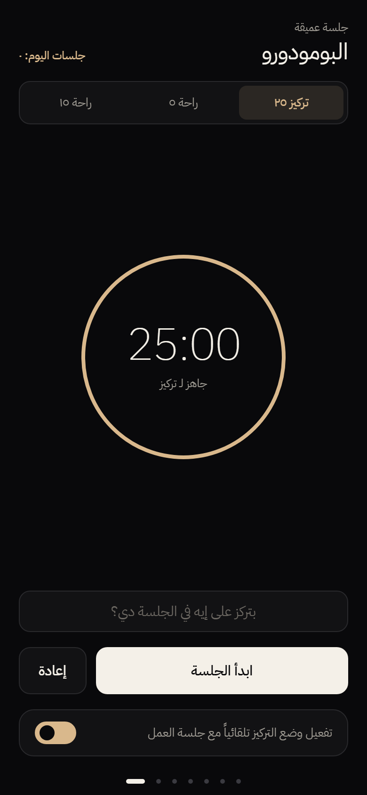
</p>

---

## 8. شاشة الإعدادات المنظمة والتخصيص الكامل

شاشة إعدادات مصممة بفلاتر أقسام سريعة (`الكل`، `المظهر والعرض`، `الروحانيات`، `التركيز والتنقل`، `النظام`) وبطاقات مجمّعة قابلة للطي:

- **طريقة عرض التطبيقات**: معاينة بصرية فورية (`نص فقط` / `أيقونات موحدة` / `أيقونات أصلية`).
- **6 ثيمات ألوان احترافية**:
  1. `داكن OLED` (أسود نقي + رملي دافئ)
  2. `فاتح ورقي` (ورق دافئ + برونزي)
  3. `زمردي ليلي` (أخضر غابات داكن + زمردي)
  4. `أزرق ليلي` (كحلي عميق + سماوي ثلجي)
  5. `إسبريسو دافئ` (بني قهوة داكن + ذهبي دافئ)
  6. `سماوي فاتح` (أبيض بارد + أزرق نيلي)
- **8 خطوط عربية + 3 أوزان**: `IBM Plex`، `القاهرة (Cairo)`، `تجوال (Tajawal)`، `المراعي (Almarai)`، `المسيري (El Messiri)`، `كوفي (Noto Kufi)`، `أميري (Amiri)`، و`خط النظام` — مع التحكم في سُمك الخط (**خفيف / عادي / عريض**).
- **مواقيت الصلاة والتنبيه الصوتي**:
  - تحديد الموقع تلقائياً بالـ **GPS** أو اختيار يدوي من 55+ مدينة.
  - **تنبيه صوتي واهتزاز قبل اقتراب الصلاة** مع تحديد المدة (`5 / 10 / 15 / 20 / 30 دقيقة`).
- **التركيز والنظام**: مدة وقفة التأمل (`3 / 5 / 10 ثوانٍ`)، الاهتزاز، ترتيب وإخفاء التابات، التحكم في الصوت، صلاحيات حجب الإشعارات وتعيين سكون كلانشر افتراضي، إعادة جولة الإعداد الأولي، أو إعادة ضبط التطبيق.

<p align="center">
  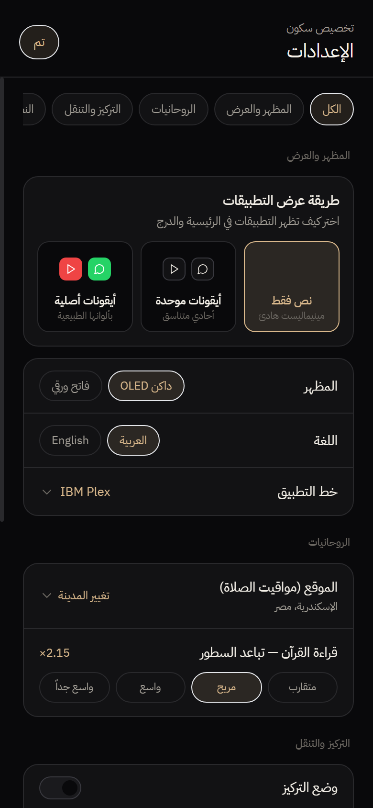
</p>

---

## 9. دليل الإيماءات والصلاحيات وبناء المشروع

### الإيماءات السريعة
| الإيماءة | الوظيفة |
|---|---|
| **سحب يمين / يسار** | التنقل بين التابات المفعّلة حول الشاشة الرئيسية |
| **سحب لأعلى (في الرئيسية)** | فتح درج كل التطبيقات |
| **سحب لأسفل (في الرئيسية)** | فتح البحث الشامل + الآلة الحاسبة + الصوت |
| **الضغط على النقاط السفلية** | الانتقال المباشر لأي تابة |
| **ضغطة مطولة (في الشاشة السوداء)** | الخروج من وضع الشاشة السوداء AMOLED |

### الصلاحيات المستخدمة (اختيارية ومطلوبة عند الحاجة فقط)
- **الموقع الجغرافي (`ACCESS_COARSE/FINE_LOCATION`)**: اختياري — يُطلب فقط عند الضغط على «معرفة موقعي تلقائياً» لحساب مواقيت الصلاة بدقة.
- **الإشعارات (`POST_NOTIFICATIONS`)**: اختياري — يُطلب على Android 13+ فقط عند تفعيل «تنبيه قبل اقتراب الصلاة».
- **الوصول للإشعارات (`NotificationListenerService`)**: اختياري — لتفعيل حجب الإشعارات أثناء وضع التركيز وتجميعها في تابة «إشعارات التركيز».
- **إمكانية الوصول (`AccessibilityService`)**: اختياري — للتسبيح عبر حساس البصمة الخلفي على الأجهزة المدعومة فقط.

### هيكلة المشروع
```text
├── android/               # تطبيق الأندرويد الأصلي (Kotlin + Jetpack Compose + Material 3)
│   └── app/src/main/
│       ├── assets/        # quran_pages.json (المصحف الكامل 604 صفحة)
│       ├── java/.../data/ # النماذج، حساب مواقيت الصلاة، الأذكار، الحفظ الذري غير المتزامن
│       ├── java/.../service/ # حجب إشعارات التركيز، تنبيهات الصلاة الصوتية، وحساس البصمة
│       └── java/.../ui/   # 6 ثيمات، 8 خطوط + أوزان، التوطين AR/EN، وجميع الشاشات
├── web-prototype/         # تطبيق الويب التفاعلي (React 18 + TypeScript + Vite + Tailwind + Zustand)
└── docs/screenshots/      # 24 لقطة شاشة عالية الدقة لتوثيق كل شاشة وتفاعل
```

### البناء والتشغيل
```bash
# 1) تطبيق الأندرويد (JDK 17, Compile SDK 35, Min SDK 26)
cd android
./gradlew assembleDebug       # أو ./gradlew assembleRelease

# 2) نموذج الويب التفاعلي
cd web-prototype
npm install
npm run dev
```
